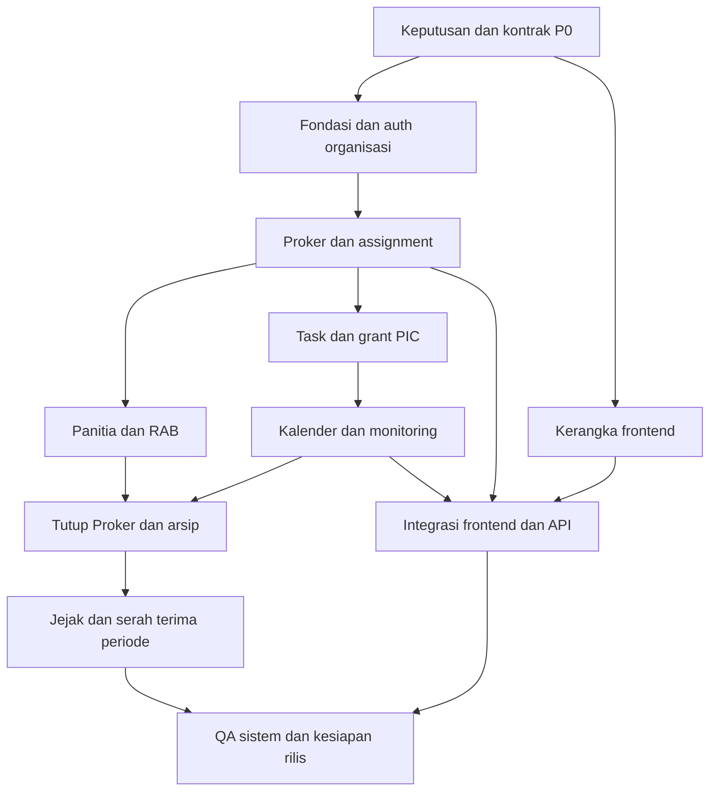

# Rencana implementasi ERP UKM P0 — PRD v1.6

Tanggal: 17 November 2026.

Status: **dokumen planning untuk review, belum merupakan implementasi aplikasi**. Pengguna meminta menyelesaikan planning terlebih dahulu. Rekomendasi untuk keputusan terbuka tetap berupa usulan; penyusunan rencana tidak otomatis menyetujui usulan tersebut.

Acuan produk: [PRD v1.6](PRD_ERP_UKM_MVP_v1.6.md). Riwayat penelaahan: [analisis v1.5 beserta status klarifikasi](ANALISIS_KESIAPAN_IMPLEMENTASI_PRD_v1.5.md). Jika ada perbedaan, keputusan final PRD v1.6 dan instruksi pengguna terbaru menjadi acuan.

## 1. Hasil yang dituju dan batas fase

Pengurus dapat login, mengelola organisasi sesuai jabatan, membuat dan mengerjakan Proker, mengisi panitia/RAB, mengelola tugas dan agenda berdasarkan scope, memantau progres, menutup Proker, serta meninggalkan Jejak kepengurusan yang dapat dibaca periode berikutnya.

- **P0:** F01–F10 dan F22; FR-001–022 serta FR-041–050. Termasuk pewarisan keanggotaan bidang, seluruh 12 jabatan Inti mengelola akun/organisasi, assignment otomatis bagi pencipta/Ketupel/PIC, pergantian Ketupel tanpa reset, serta arsip periode hanya oleh Ketua Umum.
- **Ditunda:** integrasi API acara publik, galeri, karya/voting, file publik, chatbot, serta implementasi P1/P2. Form Builder/versioning, inventaris, realisasi biaya/LPJ dan Short Link tetap backlog resmi; tidak dimasukkan diam-diam ke P0.
- **Stack final:** Next.js existing, satu FastAPI modular monolith, SQLAlchemy 2, Alembic, dan satu PostgreSQL **di luar Docker**. Modifikasi deployment kelak mengikuti `docker-compose.yml` dan `docker-compose-dev.yml` existing; tidak membuat container database atau database pengganti.
- **Pelestarian frontend publik:** tidak menulis ulang landing page/halaman acara untuk pekerjaan ini. API publik yang ditunda boleh tetap belum tersedia; pengurus tidak boleh bergantung pada API tersebut untuk memakai ERP.
- **Cara kerja:** perubahan aplikasi, instalasi dependensi, migrasi, pengujian database, dan deployment belum dijalankan melalui tugas planning ini.

## 2. Baseline repository yang sudah diperiksa

| Area | Kondisi saat perencanaan | Pengaruh terhadap rencana |
|---|---|---|
| Branch | `generaldivision` | Jangan mengasumsikan push/deploy production menjadi bagian planning |
| Backend | Folder `Backend/` dan `backend/` tidak ada setelah penghapusan sebelumnya | Buat fondasi backend baru; hasil test atau migrasi historis tidak berlaku sebagai bukti checkout sekarang |
| Frontend admin | `frontend/app/admin/` tidak ada | Rute pengurus dibangun ulang dari kontrak baru, bukan mengandalkan komponen dashboard lama |
| Frontend existing | Next.js 16.2.1, React 19, TypeScript strict, Tailwind, Base UI, Lucide | Utamakan paket yang tersedia; jangan menganggap seluruh komponen form/dialog/table sudah ada |
| Layout publik | `frontend/app/layout.tsx` memasang ChatWidget secara global | Tambahkan batas route agar chatbot tidak masuk ruang pengurus; pertahankan perilaku publik existing |
| Routing API | Rewrite Next.js saat dev ke `localhost:8000`; Nginx dev mengembalikan 503 untuk seluruh `/api/` | Integrasi ERP memerlukan perbaikan routing yang membedakan host development dan jaringan container |
| Compose production | Frontend dan jaringan eksternal `caddy_net` | Tambahkan backend pada pola existing; konfigurasi reverse proxy production perlu diverifikasi pada lingkungan target |
| Compose development | Frontend dan Nginx | Hubungkan backend di jaringan yang tepat; PostgreSQL tetap eksternal terhadap Compose |
| CI/CD | Workflow production saat ini melakukan sinkronisasi kode dan `compose up`, belum memuat gate migrasi/health/restore | Pisahkan CI verifikasi dari rollout; migrasi tunggal tidak boleh dibatalkan di tengah jalan oleh deployment berikutnya |

Baseline di atas berasal dari pembacaan source, **bukan hasil menjalankan server, Docker, database, atau hosted deployment**. `.env` tidak dibaca dan kredensial tidak disalin untuk menyusun rencana.

## 3. Keputusan terbuka dan batas pekerjaan yang bergantung padanya

Paket yang tidak bergantung pada keputusan di bawah dapat dimulai setelah ada instruksi implementasi. Ketika modul bergantung pada keputusan produk yang belum final, kontrak/modul itu belum boleh dinyatakan selesai hanya berdasarkan asumsi.

| ID | Keputusan produk | Usulan untuk review | Harus selesai sebelum |
|---|---|---|---|
| D01 | Serah terima periode dan jabatan penerus | Inti menyiapkan periode/pengurus penerus; Ketua Umum mengarsipkan periode lama setelah penerus siap. Akun tetap tersimpan; hak mengikuti jabatan/keanggotaan aktif. Tidak menyalin progres lama otomatis | Kontrak aktivasi/arsip periode dan UAT handover |
| D02 | Penugasan manual Proker HR/tingkat UKM | Seluruh Inti dapat mengelolanya; aturan departemen tetap berlaku untuk Proker berdepartemen | Policy assignment nondepartemen |
| D03 | Pencabutan grant PIC dan pencabutan manual ketika masih PIC | Grant mempunyai provenance; berakhirnya satu PIC hanya mengakhiri grant dari PIC tersebut. Grant sah lain tetap berlaku. Tentukan juga apakah cabut manual harus mengganti PIC dahulu | Mutasi assignment/PIC dan test revocation |
| D04 | Assignment Ketupel lama setelah penggantian | Hak khusus Ketupel berpindah; grant karena jabatan Ketupel lama berakhir. Grant manual/PIC lain tetap berlaku | Endpoint ganti Ketupel dan sinkronisasi izin |
| D05 | Izin nama panitia serta hapus/reset divisi berisi anggota | Pengelola mengisi nama panitia; struktur hanya Ketupel. Hapus/reset memerlukan pemindahan anggota dan penanganan referensi PIC, bukan cascade yang menghilangkan histori | CRUD panitia/struktur dan validasi referensi |
| D06 | Kalender pribadi independen dan transfer scope tugas | MVP hanya agregasi `Jadwal Saya`; task tetap pada scope asal. Kalender privat dan transfer scope ditunda | Kontrak kalender/task dan penyelesaian layar terkait |
| D07 | Pilihan/perubahan unit pemilik Proker | Inti memilih unit saat pembuatan; perubahan owner setelah dibuat ditunda agar tidak memindahkan kewenangan assignment tanpa aturan | Skema/create Proker dan policy owner |

Rincian teknis seperti format error, penamaan indeks, pilihan bentuk provenance grant, dan cara pagination dapat diputuskan tim selama memenuhi PRD. Siapkan daftar dependensi beserta alasan; paket baru mengikuti ketentuan persetujuan pengguna sebelum dipasang. Jangan membuka kembali keputusan final Next.js, PostgreSQL di luar Docker, no-approval Proker/RAB, atau hak seluruh Inti.

## 4. Tahap 0 — kunci kontrak dan cara integrasi

**Hasil:** kontrak yang cukup stabil agar backend domain, frontend, dan QA bisa bekerja paralel.

1. Finalisasi matriks identitas/aksi/scope, termasuk definisi `active` untuk akun, jabatan, keanggotaan, assignment, dan periode. Bedakan penunjukan PIC Proker, pencatatan nama panitia biasa, dan pemberian keanggotaan unit.
2. Susun ERD dan kamus data P0: users, members, periods, units, memberships, positions, programs, assignment efektif dan sumber grant, committee, budget lines, tasks, calendar, audit. Tentukan satu sumber Ketua Pelaksana dan referensi periode untuk seluruh progres yang diarsipkan.
3. Tentukan kontrak sesi serta OpenAPI untuk login/logout/me, akun/organisasi, periode, Proker, assignment/PIC, panitia, RAB, task, kalender, monitoring, dan Jejak. Endpoint pengurus diberi namespace konsisten, misalnya `/api/admin/...`; proxy tidak boleh menambahkan/membuang prefix dua kali.
4. Tetapkan satu bentuk error dan pagination; bedakan 401, 403, 404, konflik versi/arsip 409, serta validasi 422. Mutasi yang diulang tidak menduplikasi grant/audit/penutupan.
5. `/me` menyediakan identitas, periode, keanggotaan efektif, jabatan, dan kemampuan global. Detail resource menyediakan kemampuan sesuai resource; frontend tidak menghitung sendiri hak edit hanya dari label Inti.
6. Tetapkan sumber tanggal Proker/task dan tampilan kalender turunannya; kalender tidak menyimpan salinan tanggal bebas edit yang dapat menyimpang.
7. Tetapkan pemilik manifest, metadata model, migration stream, routing proxy, dan file shared. Perubahan kontrak harus diumumkan kepada pemilik frontend/domain/test sebelum digabungkan.

**Gate G0:** keputusan yang memengaruhi paket pertama sudah final; kontrak auth/org serta policy dan ERD awal disepakati; ruang implementasi berikutnya sudah diinstruksikan pengguna. Dokumen ini sendiri tidak melewati gate tersebut secara otomatis.

### 4.1 Rancangan kontrak HTTP

Path berikut **usulan kontrak**, bukan endpoint existing. Namespace dipilih sekali sebelum frontend dan backend berpisah bekerja; tabel ini memakai `/api/admin` secara konsisten.

| Kelompok | Contoh kontrak yang direncanakan | Pemeriksaan utama |
|---|---|---|
| Auth | `POST /api/admin/auth/login`, `POST /api/admin/auth/logout`, `GET /api/admin/me` | Sesi, rate limit login, akun aktif, identitas dan hak terbaru |
| Organisasi | `/api/admin/users`, `/members`, `/units`, `/memberships`, `/position-assignments` | Seluruh 12 jabatan Inti boleh mengelola; daftar dan mutasi mempunyai policy terpisah |
| Periode | `/api/admin/periods`, `POST /api/admin/periods/{id}/archive`, `GET /api/admin/periods/{id}/history` | Aktivasi/handover mengikuti D01; arsip hanya Ketua Umum target periode |
| Proker | `/api/admin/programs`, `POST /api/admin/programs/{id}/close`, `PUT /api/admin/programs/{id}/chairperson` | Inti membuat/mengganti Ketupel; assignment mengatur edit; penutupan mengikuti PRD |
| Assignment/panitia/RAB | Subresource `/api/admin/programs/{id}/assignments`, `/committee`, `/committee/structure`, `/committee/members`, `/budget` | Provenance akses, struktur hanya Ketupel, anggota nonakun, total uang server |
| Pekerjaan | `/api/admin/tasks`, `/api/admin/calendar-events`, `/api/admin/dashboard`, `/api/admin/monitoring/units` | Scope, sumber tanggal, grant PIC, filter personal/periode/arsip dan agregasi |
| Health | `GET /api/health`, `GET /api/ready` | Liveness dan readiness terpisah; tidak membocorkan target/kredensial database |

Path pendek pada baris organisasi dan subresource mengikuti prefix penuh kelompok masing-masing. Method CRUD, DTO, batas input dan respons error ditetapkan dalam OpenAPI W00 sebelum paket terkait selesai. Audit wajib sebagai catatan transaksi; endpoint pembaca audit hanya dibuat setelah policy pembacanya ditentukan, bukan menambah akses log sensitif secara otomatis.

**Usulan sesi:** cookie sesi opaque HttpOnly/Secure/SameSite dengan hash sesi pada PostgreSQL, TTL dan invalidasi yang terdokumentasi. Backend menjadi pemilik autentikasi; Next.js tidak membuat sistem role atau sesi paralel. Rancang CSRF untuk mutasi berbasis cookie serta forwarding cookie pada request server Next.js. Jangan menyimpan token sesi di localStorage. Pilihan mekanisme ini merupakan rancangan teknis W00, bukan klaim implementasi yang tersedia.

### 4.2 Integritas dan transaksi lintas modul

- Satu assignment efektif user/Proker dapat ditopang beberapa sumber: pencipta, Ketupel, manual, dan beberapa task PIC. Jangan memakai satu label sumber yang menimpa sumber sebelumnya. Revoke harus mengikuti keputusan D03/D04.
- Relasi scope task harus dapat divalidasi dengan foreign key/CHECK atau bentuk setara; seluruh relasi panitia/PIC/task/Proker harus berada pada Proker dan periode yang benar. Unit dan struktur panitia tidak boleh mempunyai parent bersiklus.
- RAB memakai bilangan uang yang akurat serta kuantitas Decimal bila dibutuhkan; definisikan pembulatan. Total backend menjadi acuan, tanpa approval.
- Guard periode merupakan bagian fondasi sebelum modul domain dibuat. Mutasi progres memeriksa/menahan state periode sampai commit; arsip harus berkonflik dengan transaksi mutasi secara nyata. Guard tidak boleh menghalangi pengelolaan akun global hanya karena orang tersebut pernah memegang jabatan pada periode arsip.
- Usulkan urutan lock konsisten: periode → Proker jika ada → resource. Mutasi anak harus bersinkron dengan close/revoke/ganti Ketupel, lalu mengevaluasi izin terbaru. Pilihan lock dibuktikan lewat dua transaksi PostgreSQL; pengecekan status sekali sebelum transaksi tidak cukup.
- PIC + sumber grant + assignment efektif + audit memakai satu unit-of-work. Pembuatan Proker, pergantian Ketupel dan penutupan juga atomik. Service anak tidak melakukan commit sendiri; satu pemilik transaksi mengakhiri operasi.
- Arsip periode dapat mengunci dari parent tanpa memaksa semua Proker menjadi CLOSED atau task menjadi DONE. Simpan identitas historis agar pergantian nama/jabatan master tidak menulis ulang Jejak. Retry tidak membuat arsip atau audit sukses berulang.

## 5. Pembagian agent dan ownership saat implementasi kelak

Tiga subagent yang digunakan untuk **menyusun planning ini** menangani backend, frontend, dan QA/deployment. Pembagian pelaksana di bawah merupakan rencana kerja berikutnya, belum penugasan implementasi yang berjalan.

| Pemilik | Area utama | File/direktori yang direncanakan | Batas perubahan |
|---|---|---|---|
| Koordinator/integrator | Kontrak lintas modul, manifest, migrasi tunggal, integrasi, QA sistem dan deployment | `Docs/`, `Backend/pyproject.toml`, lockfile, `Backend/alembic/`, entrypoint app, Compose existing, Nginx, workflow | Satu penulis untuk migration stream, dependensi, dan konfigurasi shared |
| Agent A — Fondasi & scope | Auth, organization, permissions, audit; dilanjutkan tasks/calendar/monitoring dan periode/Jejak | `Backend/app/core/`, modul `auth`, `organization`, `permissions`, `audit`, `tasks`, `calendar`, `monitoring`; test modul terkait | Tidak menulis repository privat domain Proker; memakai application service/kontrak yang diekspos |
| Agent B — Operasional Proker | Proker, assignment/provenance, Ketua Pelaksana, panitia, RAB, penutupan | Modul `programs`, `budgets`; test modul terkait | Mengusulkan perubahan skema ke pemilik migrasi; tidak membuat migration head sendiri atau mengubah policy shared tanpa koordinasi |
| Agent C — Frontend | Ruang pengurus, integrasi API, UX dan pemeriksaan browser | `frontend/app/admin/`, `frontend/app/lib/erp/`, `frontend/app/components/erp/`, test frontend yang relevan | Perubahan root layout/globals/middleware diajukan sebagai patch kecil yang diperiksa koordinator; tidak mengubah landing page publik |

Path `Backend/` adalah **rancangan folder baru**, dipilih konsisten dengan konvensi historis repo; jangan membuat `Backend/` dan `backend/` sekaligus. Susunan modul boleh disesuaikan saat kontrak dikunci. Tiap paket mencakup test milik modulnya; QA bukan pekerjaan yang seluruhnya ditunda sampai akhir.

Semua agent membaca `.agent/STATE.md` dan instruksi lokal yang relevan sebelum bekerja. Tidak menjalankan reset/clean terhadap perubahan pengguna. Tidak ada agent yang mengedit file milik pemilik lain tanpa pemberitahuan dan serah terima yang jelas.

## 6. Paket kerja dan kriteria selesai

| Paket | Hasil kerja | Dependensi | Pemilik | Kriteria selesai |
|---|---|---|---|---|
| W00 — Kontrak | Keputusan D01–D07 yang relevan, matriks policy, ERD, OpenAPI awal, daftar dependensi | Instruksi implementasi dan keputusan produk terkait | Koordinator + semua agent | Backend/frontend memakai arti status, ID, scope, versi, error, dan prefix API yang sama |
| W01 — Fondasi runtime | FastAPI modular, konfigurasi tervalidasi, koneksi PostgreSQL eksternal, health/readiness, transaksi/audit, test harness | W00 fondasi; persetujuan paket baru | A + koordinator | Startup gagal jelas tanpa konfigurasi; liveness/readiness dibedakan; tidak ada DB Docker atau fallback SQLite |
| W02 — Auth & organisasi | Login/logout, `/me`, sesi, pengelolaan akun/anggota/unit/jabatan/membership, periode awal, bootstrap | W01 + kontrak identitas | A | Semua 12 jabatan Inti dapat mengelola; non-Inti ditolak; anggota bidang mewarisi departemen; nonaktifkan akun/ubah izin berlaku pada sesi berjalan |
| W03 — Kerangka frontend | Login, shell pengurus, navigasi, context sesi, typed API client, error/empty/loading states, boundary ChatWidget | Kontrak auth/org; API hidup untuk integrasi akhir | C | `/admin/login` dapat diakses tanpa sesi; halaman internal terproteksi; pengurus tidak memanggil API chatbot; halaman publik dipertahankan |
| W04 — Proker & assignment | Create direct-ACTIVE, list/detail lintas unit, Proker Saya/Semua, assignment awal dan manual, ganti Ketupel, provenance grant | W01 + policy org; D02/D03/D04/D07 terkait | B | Pencipta/Ketupel mendapat satu assignment efektif tanpa duplikasi; edit sesuai assignment; penggantian Ketupel tidak mereset data; perubahan akses diaudit |
| W05 — Panitia & RAB | Template fleksibel, struktur Ketupel, anggota tanpa akun, CRUD RAB dengan total server | W04 + D05 | B | Template tidak memberi akun/akses otomatis; angka uang akurat; non-Ketupel tidak mengubah struktur; referensi anggota/PIC tidak rusak |
| W06 — Task & grant PIC | Empat scope, PIC, status, deadline, optimistic conflict, satu record banyak view | W02 + kontrak assignment W04; D03/D06 | A, dengan B untuk service grant | Task Umum/unit/Proker punya hak yang benar; PIC Proker mendapat akses edit secara atomik; akses ke Proker lain tidak ikut terbuka |
| W07 — Kalender & monitoring | Kalender berdasarkan sumber tanggal/scope, Jadwal Saya agregat, hitungan lintas unit, dashboard personal | W04/W06 + D06 | A + C untuk layar | Tidak ada tanggal input ganda atau task terhitung ganda; progres arsip tidak masuk kalender/pekerjaan aktif |
| W08 — Tutup Proker | Ringkasan, warning, konfirmasi, lock/mutasi atomik, arsip Proker | W04–W07 | B + C | Task tersisa tidak memblokir dan tidak berubah DONE; seluruh mutasi terkait ditolak setelah CLOSED, termasuk lewat agregat/retry |
| W09 — Jejak periode | Persiapan penerus, arsip periode, browse progres lama, readonly lintas periode | W02/W04–W08 + D01 | A + C, review koordinator | Hanya Ketua Umum arsip periode; penerus dapat membaca Jejak; tidak ada mutasi lolos saat pengarsipan; histori orang/jabatan tetap akurat |
| W10 — Integrasi/rilis | QA lintas modul, migrasi teruji, routing container, backup/restore, browser, profiling, runbook | Seluruh paket dan target lingkungan yang disepakati | Koordinator + semua agent | Seluruh gate rilis terpenuhi dengan bukti; pekerjaan tidak dinyatakan deployed hanya dari build/config valid |

Tidak ada paket yang selesai hanya karena halaman dapat dibuka memakai fixture atau test policy satu fungsi lulus. Paket yang bersifat lintas frontend/backend harus diuji melalui API nyata pada lingkungan yang disepakati.

## 7. Gelombang kerja paralel dan urutan integrasi

| Gelombang | Koordinator | Agent A | Agent B | Agent C |
|---|---|---|---|---|
| 0 — Rancangan bersama | Satukan keputusan, kontrak, ownership dan gate | ERD identitas/periode dan interface policy | ERD operasi dan interface grant/lifecycle | Kontrak `/me`, route dan state interaksi |
| 1 — Fondasi | Review manifest/migrasi awal; susun test lintas peran | W01/W02 dan audit | W04 berdasarkan interface policy yang sudah dikunci | W03 berdasarkan kontrak; integrasi auth saat endpoint siap |
| 2 — Operasional | Integrasikan migrasi serial dan jalankan skenario negatif | W06 kemudian W07 setelah fondasi identitas stabil | W05 dan penguatan W04 | Layar Proker/panitia/RAB, lalu task/kalender sesuai kesiapan API |
| 3 — Arsip | Uji race, revocation dan konsistensi lintas modul | W09 setelah aturan handover final | W08 dan integrasi grant PIC/revocation | Dashboard/monitoring, penutupan Proker, Jejak dan izin organisasi |
| 4 — Stabilitas | W10, smoke lingkungan target dan bukti verifikasi | Perbaikan policy/query/periode | Perbaikan lifecycle/transaksi | Browser mobile/desktop, aksesibilitas dan error handling |

Pekerjaan setelah gelombang 0 dapat tumpang tindih sesuai dependensi, bukan menunggu seluruh backend selesai sebelum frontend mulai. Mock/fixture boleh dipakai untuk test kontrak/komponen yang jelas ditandai; tidak menjadi database dummy atau fallback sukses pada produk.

**Urutan penggabungan:** fondasi/model kontrak → auth/org/policy → Proker/assignment → panitia/RAB → task/PIC → kalender/monitoring → CLOSED/Jejak → deployment. Migration revision dan mutasi database tetap serial walaupun perubahan modul dikerjakan paralel. Kontrak grant harus diuji kedua pemilik sebelum task PIC digabungkan.

## 8. Rencana frontend dan alur pengurus

Arahan desain pengguna (17 November 2026), menjadi acuan Agent C dan review koordinator:

- **Palet:** kurang lebih merah dan hitam; kode warna/token final belum dikunci. Gunakan netral pendukung dan kontras yang terbaca untuk form, tabel, serta state interaksi.
- **Design system:** komponen dari [21st.dev](https://21st.dev/) boleh dipakai dan diselaraskan dengan stack existing. Pilihan komponen tidak otomatis menyetujui pemasangan paket baru.
- **Skill:** gunakan [gpt-taste lokal](../.agent/skills/gpt-taste/SKILL.md), khusus webUFT sesuai registrasi `AGENTS.md`. Terapkan pada konteks ERP dan prinsip mobile-first; pola halaman promosi/animasi sinematik hanya dipakai bila sesuai fungsi layar, tanpa mengubah halaman publik yang dipertahankan.

Rute berikut merupakan rancangan implementasi di namespace `/admin`; nama akhir diselaraskan dengan kontrak saat gelombang 0.

| Alur | Rute yang direncanakan | Perilaku utama |
|---|---|---|
| Sesi | `/admin/login`, logout dari shell | Login username/password; sesi invalid kembali ke login tanpa menampilkan data lama |
| Beranda | `/admin` | Tugas Saya, Proker Saya, agenda terdekat; bukan daftar semua Proker UKM |
| Proker | `/admin/proker`, `/admin/proker/baru`, `/admin/proker/[id]` | Filter Saya/Semua/Arsip; tab ringkasan, tugas, panitia, RAB; capability per-resource menentukan tombol |
| Kanban | `/admin/tugas` | Pilih Umum/unit/Proker; mode list untuk layar kecil; tombol status dan pindah kolom dapat diakses keyboard |
| Detail tugas | `/admin/tugas/[id]` | Tautan dari Tugas Saya langsung membuka tugas dan papan asal, tanpa meminta memilih board ulang |
| Kalender | `/admin/kalender` | Filter umum/unit/Proker/pribadi agregat; scope menentukan hak mutasi; arsip tidak tampil |
| Monitoring | `/admin/monitoring` | Ringkasan unit dan drill-down sesuai hak yang ditetapkan; jumlah task konsisten dengan sumber |
| Organisasi | `/admin/organisasi`, `/admin/akun` | Seluruh Inti mengelola akun, keanggotaan dan jabatan; kemampuan organisasi tidak menjadi bypass edit Proker |
| Jejak | `/admin/jejak`, `/admin/jejak/[periodId]` | Pilih periode, baca histori termasuk pekerjaan belum selesai; aksi arsip periode hanya bagi Ketua Umum |

Gunakan komponen existing yang sesuai; jangan menambah paket drag-and-drop, kalender, tabel, atau state management sebelum kebutuhan dan alasannya ditinjau. Read-only mempunyai penjelasan yang jelas. Tangani kegagalan 401/403/409, data kosong, perubahan hak saat halaman terbuka, submit ganda, dan retry tanpa menimpa pekerjaan pengguna lain.

**Susunan route:** `/admin/layout.tsx` hanya menjadi wrapper; `/admin/login/page.tsx` berada di luar route group terlindung. Shell/pemeriksaan sesi ditempatkan pada `/admin/(workspace)/layout.tsx`, dengan halaman Proker/tugas/kalender/Jejak di bawahnya. Route group tidak menambah segmen URL dan mencegah login berulang karena halaman login ikut dilindungi. Komponen/query task dan kalender dipakai ulang pada tab Proker, bukan diduplikasi.

**Boundary shared:** ChatWidget harus tidak dirender pada `/admin` dan turunannya di titik pemasangan pada root; menyembunyikannya lewat CSS atau nested layout saja tidak menghentikan mount/request. Style pengurus dicakup pada wrapper/stylesheet admin untuk menghindari perubahan dark-mode/font/ScrollReveal publik. Feedback pengurus memakai teks/ikon tanpa emoji; jangan otomatis memakai Toast publik yang masih mengandung emoji. Resource yang status historisnya ACTIVE tetapi periodenya ARCHIVED tetap ditampilkan read-only berdasarkan capability server.

Setelah perubahan PIC, Ketupel, penutupan atau arsip, invalidasi/refetch resource dan capability terkait. Jika 409 terjadi, pertahankan input yang belum tersimpan dan tawarkan pemuatan versi terbaru; jangan retry dengan menimpa data secara diam-diam. Return URL setelah login harus merupakan tujuan internal yang tervalidasi.

Validasi mobile paling tidak 320/360/390 px dan desktop; periksa overflow, label, fokus keyboard, dialog konfirmasi, serta alternatif interaksi drag. Baca panduan Next.js yang tersedia di instalasi lokal sebelum menulis kode sesuai `frontend/AGENTS.md`. Perubahan `middleware.ts` atau konvensi proxy Next.js tidak boleh merusak routing shortlink existing.

## 9. Rencana pengujian dan bukti penerimaan

| Kelompok | Cakupan utama | Bukti yang wajib tersedia |
|---|---|---|
| Identitas/organisasi | FR-001–005, FR-045; UAT-03/27/28 | Semua 12 jabatan Inti diuji, non-Inti 403, sesi akun nonaktif invalid, membership bidang→departemen, rangkap jabatan |
| Proker/penugasan | FR-006–014, FR-046/048; UAT-01–06/23/29/30 | ACTIVE langsung, baca lintas unit, assignment awal dedup, Ketupel per-Proker, pergantian mempertahankan progres, edit tanpa assignment ditolak |
| Panitia/RAB | FR-015/041–044; UAT-24–26 | Nama tanpa akun, struktur hanya Ketupel, total akurat, referensi anggota/PIC dan histori terjaga |
| Task/PIC | FR-016–019/047; UAT-07–09/31 | Satu sumber task, scope tidak menjadi bypass, grant PIC lintas unit hanya Proker terkait, revocation sesuai D03/D04 |
| Kalender/monitoring | FR-020–021/050; UAT-12/32/33 | Hak agenda mengikuti scope, tanggal konsisten, agregasi tidak ganda, CLOSED/periode arsip tidak masuk kalender aktif |
| Audit/arsip/Jejak | FR-022/049, NFR-16; UAT-10/11/22/34–36 | Warning unfinished, arsip read-only lewat semua endpoint, hanya Ketua Umum arsip periode, penerus dapat baca, audit dan mutasi atomik |
| Sistem/operasi | NFR P0 dan UAT-37 | Koneksi PostgreSQL eksternal, proxy/API/sesi dalam container, migrasi terarah, restore, health, build/lint, browser, pengukuran resource |

**Kasus bersamaan dan negatif yang wajib:** tutup Proker beradu dengan edit task/RAB; arsip periode beradu dengan mutasi task umum/unit/Proker; dua perubahan PIC; ganti Ketupel beradu dengan perubahan struktur; pencabutan akses ketika sesi masih aktif; retry setelah respons terputus. Periksa data dan audit, bukan hanya status HTTP.

Test domain/policy dan kontrak dapat dimulai paralel. Test integrasi database memakai PostgreSQL eksternal yang telah ditentukan sebagai target uji aman; **jangan memakai database unknown/production untuk eksperimen**, jangan menambah DB Docker atau mengganti dengan SQLite. Jika target uji belum tersedia, catat test integrasi terblokir; jangan mengklaim test policy membuktikan transaksi PostgreSQL.

Perintah verifikasi aplikasi baru ditetapkan setelah manifest dan runner tersedia. Frontend memiliki `npm run build` dan `npm run lint`; typecheck menggunakan TypeScript lokal. Jika tipe `.next` masih merujuk route admin lama, regenerasi tipe route menggunakan CLI Next.js yang terpasang sebelum typecheck; jangan menurunkan strictness untuk melewati cache lama. Gunakan ESLint langsung, bukan `next lint`. Backend direncanakan memiliki test runner yang disepakati, migrasi Alembic, dan pemeriksaan batas modul. Browser automation hanya dipakai jika tersedia atau dependensinya sudah disetujui; runner test browser/unit belum terdaftar dalam `frontend/package.json` yang diperiksa.

Pemetaan P0 mencakup **32 FR** dan **28 skenario UAT**: FR-001–022/041–050; UAT-01–12/22–37. FR-023–040 dan UAT-13–21 ditunda sebagai P1. Laporkan hasil passed/failed/blocked/deferred secara eksplisit; jangan menulis seluruh 37 UAT lulus ketika sembilan skenario P1 belum dikerjakan.

## 10. Database eksternal, migrasi dan deployment

1. **Preflight target:** verifikasi koneksi, database/schema, tabel existing, riwayat migrasi dan hak akses tanpa mencetak kredensial. Putuskan fresh schema atau pemetaan data existing berdasarkan hasil nyata; jangan mengasumsikan database kosong karena kode backend dihapus.
2. **Satu migration stream:** hanya pemilik migrasi membuat/menyatukan revision setelah perubahan model direview. Tidak menjalankan `drop`, `reset`, migrasi destruktif atau transformasi data tanpa persetujuan target dan tindakan. Jangan mengubah revision yang sudah diterapkan atau memalsukan riwayat untuk membuat migrasi terlihat lulus.
3. **Bootstrap:** akun pertama, organisasi dan periode awal dibuat lewat mekanisme idempotent yang disepakati; tidak ada password hardcoded dan tidak ada seed yang menimpa data existing diam-diam.
4. **Compose existing:** tambahkan FastAPI pada jaringan yang sesuai; Next.js/FastAPI memakai koneksi PostgreSQL di luar Docker. URL internal container menggunakan service backend/host database yang valid, bukan mengandalkan localhost container.
5. **Routing:** aktifkan namespace API pengurus yang disepakati pada Nginx dev/reverse proxy prod. Tetap biarkan API publik yang ditunda belum aktif; jangan membuat catch-all sukses palsu. Uji header host/proto, cookie/session, serta prefix path secara end-to-end.
6. **CI dan rollout:** build/lint/test sebelum rilis. Rollout melakukan preflight/backup sesuai runbook → migrasi tunggal → restart → readiness/smoke. Tinjau `cancel-in-progress: true` existing agar fase migrasi tidak diputus oleh push lain. Jangan menjalankan migrasi secara otomatis dari setiap worker/container.
7. **Recovery:** tetapkan backup off-host, retensi, pemilik restore, target kehilangan data/waktu pemulihan, dan uji restore ke lingkungan eksternal yang disepakati. Rollback aplikasi mempertimbangkan kompatibilitas schema; jangan otomatis menjalankan downgrade yang menghilangkan data.
8. **Pengukuran:** ukur RAM Next.js/FastAPI, latensi, koneksi PostgreSQL, dan disk dengan dataset/beban yang dicatat. Target p95 PRD merupakan target uji, bukan hasil. Rencana rilis bukan izin melakukan deployment production saat tugas planning.

## 11. Gate penyelesaian dan estimasi

| Gate | Syarat |
|---|---|
| G0 — Siap mulai | Kontrak fondasi dan keputusan produk yang memengaruhi paket awal final; scope implementasi dan dependensi yang diperlukan sudah disetujui |
| G1 — Fondasi terintegrasi | Login/logout nyata, hak 12 Inti/membership, koneksi PostgreSQL eksternal dan migrasi baseline terverifikasi di target uji aman |
| G2 — Proker operasional | Proker/panitia/RAB/task/PIC dan kalender/monitoring terhubung melalui API; test akses positif-negatif dan revocation lulus |
| G3 — Arsip dan Jejak | Penutupan/arsip periode read-only, unfinished tetap historis, penerus tidak terkunci; test race, audit dan agregasi lulus |
| G4 — Layak diuji pengguna | Build/lint/test relevan lulus, browser mobile/desktop, migrasi dan restore terbukti; sisa batas lingkungan dijelaskan |
| G5 — Layak rilis nyata | UAT pengurus, parameter resource, target deployment, backup/recovery dan pemilik operasional jelas; rollout dan health lingkungan target diverifikasi |

Target empat minggu dari PRD dapat dipakai sebagai kerangka: minggu 1 fondasi/kontrak, minggu 2 Proker/panitia/RAB, minggu 3 task/kalender/monitoring/Jejak, minggu 4 integrasi/stabilitas/UAT. **Ini belum estimasi terjamin.** Waktu keputusan produk, ketersediaan PostgreSQL uji, dependensi baru, kondisi data existing, dan perbaikan integrasi dapat mengubah jadwal. Paralelisme mengurangi waktu menunggu antarmodul, tetapi tidak menghilangkan dependensi auth, kontrak, migrasi dan arsip.

## 12. Langkah pertama setelah planning

1. Tinjau D01–D07 dan tandai mana yang final; usulan yang belum diputuskan tetap terbuka.
2. Setelah ada instruksi implementasi, jalankan W00/W01/W03 sesuai dependensinya; jangan mulai seluruh modul tanpa kontrak shared.
3. Lanjutkan gelombang paralel dengan ownership di atas, satu migration stream, dan pemeriksaan per paket.
4. Perbarui `.agent/STATE.md` dengan posisi, blocker dan bukti verifikasi yang benar-benar dijalankan; simpan keputusan baru beserta alasannya di `.agent/DECISIONS.md`.

Deliverable tugas sekarang adalah dokumen ini dan hasil penelaahan paralel. Tidak ada klaim backend baru, frontend pengurus, migrasi, deployment atau test aplikasi telah selesai.

## 13. Kontribusi subagent pada planning ini

| Subagent | Penelaahan yang selesai | Hasil yang digabungkan |
|---|---|---|
| `plan_backend` | Fondasi, model/constraints, policy, provenance grant, transaksi dan arsip | Kontrak awal, ownership backend/migrasi, guard periode sejak fondasi, urutan lock dan gate keputusan |
| `plan_frontend` | Struktur Next.js, route/group, komponen existing, sesi/capability, mobile dan shared layout | Pemisahan login dari shell, boundary ChatWidget, style scoped, deep link task dan kriteria integrasi nyata |
| `plan_qa_deploy` | FR/UAT, PostgreSQL eksternal, Compose/proxy/CI, migrasi, recovery dan resource | Matriks 32 FR/28 UAT P0, test dua transaksi, satu migrator, preflight, health/recovery dan gate rilis |

Ketiga subagent menyelesaikan penelaahan tanpa mengubah aplikasi, memasang paket, menghubungkan database, atau menjalankan deployment. Rencana akhir disatukan dan diperiksa koordinator; pembagian pelaksana masa depan di §5 bukan klaim bahwa implementasi telah dimulai.
